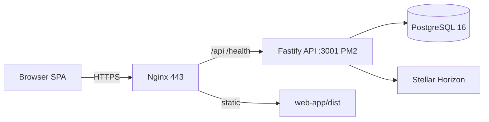
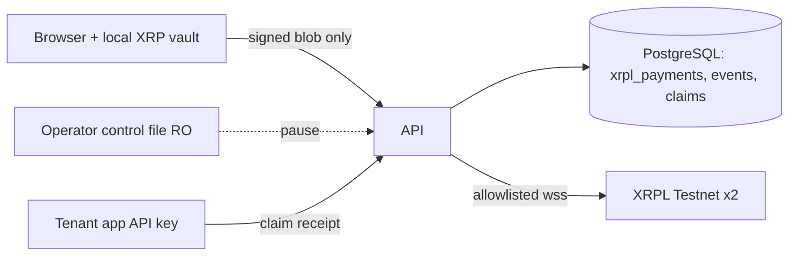
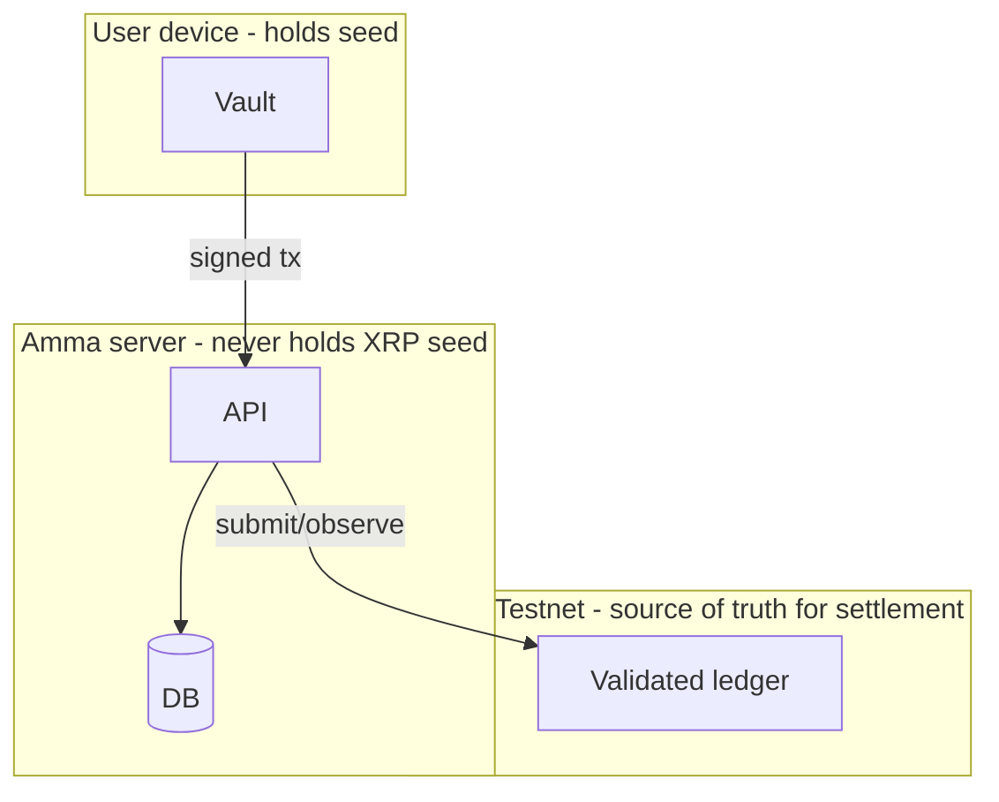
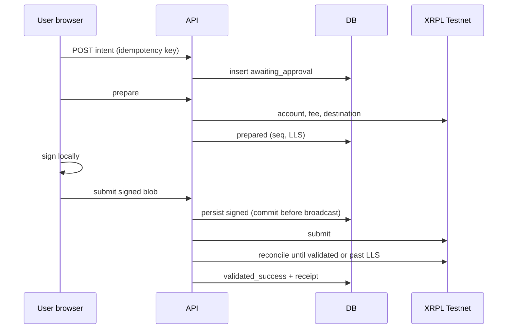
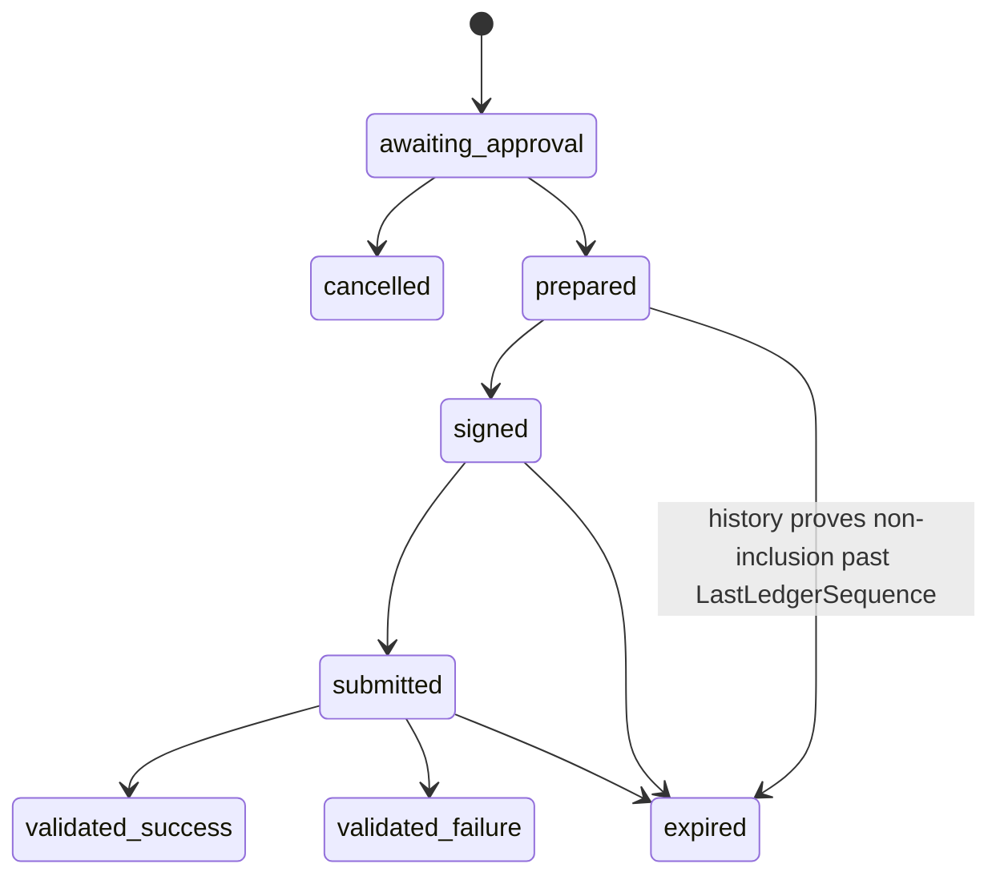
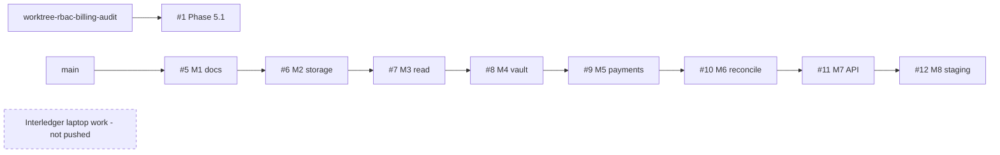
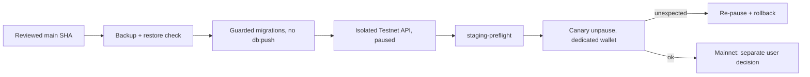

# Diagrams

## Current architecture (implemented, production per docs/DEPLOYMENT.md)

## Target with XRP Testnet (implemented on PR stack, not deployed)

## Trust boundaries

## XRP payment sequence

## Payment state and recovery

Review holds are not states. `lastObservation` values `INTEGRITY_MISMATCH`, `LEDGER_RESET`,
`SEQUENCE_CONSUMED` and `TRANSACTION_ALREADY_BOUND` freeze submission and rebroadcast on the
current state until a human reviews them. A timeout never creates a replacement transaction.

## PR dependency order

## Deployment (gated)

