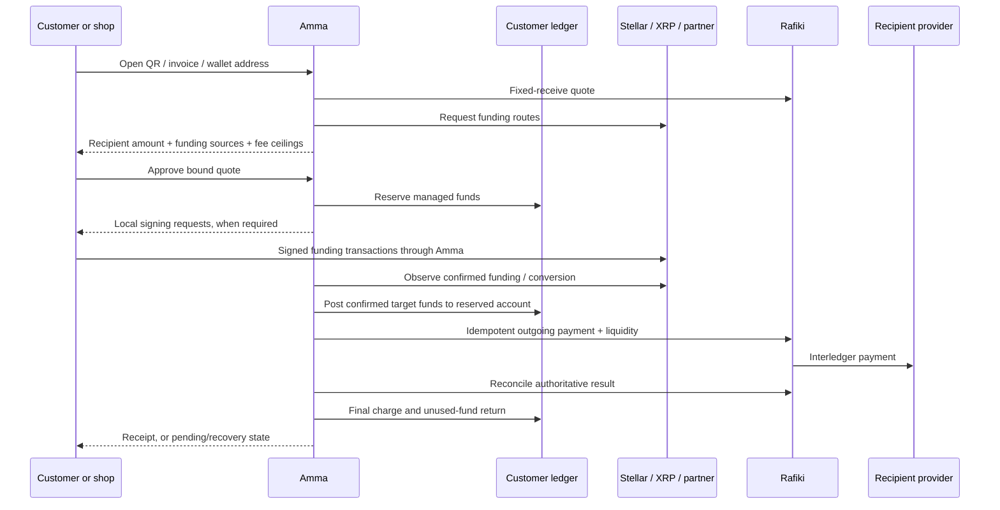

# Amma Open Payments implementation

This checkout is an isolated implementation based on the existing native-XRP
candidate `2cfd779`. It does not modify the ongoing XRP checkout or the two older
`amma-wallet-production2` copies. Nothing here has been deployed or enabled on
mainnet.

## Implemented

- Exact integer amounts and identities containing chain, network, issuer, and scale.
- Customer ledger independent of tenant billing. Every immutable posting contains
  both debit and credit accounts in the same asset. Customer and reserved balances
  cannot become negative. A reconciliation command compares balances with postings.
- Funding planning across managed accounts, Stellar assets, and native Testnet XRP.
  Alternative routes for one source cannot double-count its balance. Fixed fees,
  network fee ceilings, reserve requirements, exclusions, and quote expiry are included.
- Persisted invoices, quotes, approvals, funding legs, receipts, invoice claims,
  idempotency records, reconciliation jobs, and webhook inbox.
- One active payment per invoice, transactional reservations, conservative per-asset
  transaction/daily limits, and serialized funding from each external wallet.
- Browser signing for Stellar and reuse of the XRP candidate's native-XRP signer
  and reconciliation service. Private keys and local passphrases are not API inputs.
- Open Payments SDK 7.4.0 for resource discovery and quotes. Rafiki Admin operations
  handle provider-owned outgoing payments with durable idempotency keys.
- GNAP consent collection, ownership checks, grant listing and revocation.
- Signed, canonical Rafiki webhooks with timestamp checks and durable deduplication.
  Webhooks are wake-ups; authoritative Admin reads drive financial postings.
- Customer checkout, merchant QR requests, supplier wallet-address payments,
  funding breakdown, local signing, status polling, history, and explicit recovery.
- Two-peer PostgreSQL/Redis/Rafiki deployment configuration and a test-only peer/key
  provisioning command, pinned to Rafiki v2.4.2-beta.

## Still requires external acceptance

| Gate | Current state |
| --- | --- |
| TDME/FiveWest integration | FiveWest public auth/RFQ/balance client and gateway interface exist. Custody, funding and corridor mappings require account verification. TDME details are pending the user's contact with them. |
| ZARC and USDC | Configure verified issuer/network identities and funded test treasury addresses. A ticker or indicative rand price is insufficient. |
| Running two-peer demo | Docker is not installed in this workspace. Compose has not been started here. Domains, TLS, keys and private endpoints must be configured on an isolated host. |
| Real ledger-to-ILP demonstration | Requires funded Stellar/XRPL Testnet wallets and a verified conversion gateway. Mixed-chain automated tests use explicitly marked fixture adapters. |
| XRP mainnet | Existing Release A remains native XRP on Testnet. This work does not remove its release gates. |
| Production | Partner operating model, settlement agreements, liquidity, security review, real PostgreSQL concurrency/restore tests, and limited pilot acceptance remain required. |
| Hackathon research/submission | Interview guide and presentation script are supplied; interviews, recording, public demo access and submission have not been performed. |

## Payment flow



Rafiki's internal ledger accounts track liquidity and obligations; they do not
replace the customer ledger. Cross-chain funding and ILP are not one atomic
transaction. Unknown outcomes retain their original references and stay unresolved.

## Local checks

From `packages/backend`:

```powershell
npm ci --ignore-scripts
npm test
npx vitest run src/modules/payments src/routes/payments.test.ts src/modules/swap/swap.service.test.ts
npx tsc --noEmit
```

The upstream candidate contains existing backend TypeScript diagnostics; inspect
the payment files separately and compare against the baseline. Do not treat the
backend's existing placeholder `build` script as a type check.

From `packages/web-app`:

```powershell
npm ci --ignore-scripts
npm run build
```

The development optimizer currently fails inside the existing `stellar-hd-wallet`
dependency. The production bundle works for browser QA. Browser fixture responses
are test evidence only, and do not demonstrate a ledger or Interledger transfer.

## Database and runtime

Use a separate staging database with the existing XRP chain/payment migrations
already accepted. Then run, from `packages/backend`:

```powershell
npx tsx src/db/migrations/migrate-payments.ts --check --expect-database=STAGING_DB_NAME
npx tsx src/db/migrations/migrate-payments.ts --apply --expect-database=STAGING_DB_NAME
```

The migration creates only new payment tables; it does not fund accounts or alter
legacy balances. Back up staging first, apply twice to check idempotency, and verify
restore before production. Rollback is feature disable plus preserved data: never
drop financial history to roll back an application release.

Merge `.env.payments.example` into staging configuration; do not replace the
existing authentication configuration. Features default off, with submissions paused.
Frontend settings are build-time flags. Set `VITE_PAYMENTS_STELLAR_TREASURY` to the
same reviewed public address as `PAYMENTS_STELLAR_TREASURY`.

`PAYMENTS_RAFIKI_ASSETS` contains one entry per payment asset:

```json
[{"asset":{"chain":"stellar","network":"testnet","code":"ZARC","issuer":"VERIFIED_TEST_ISSUER","scale":7},"assetId":"RAFIKI_ASSET_ID","senderId":"TREASURY_WALLET_ADDRESS_ID","senderUrl":"https://pay-a.stage.example/treasury/zarc"}]
```

Use exact identities; replace the placeholder issuer. Fiat ZAR is a separate
partner-backed asset, not an alias for ZARC. Local Open Payments resource, auth,
and recipient origins must be explicitly included in `OPEN_PAYMENTS_ALLOWED_ORIGINS`.

`PAYMENTS_MAX_RECEIVE_UNITS` and `PAYMENTS_DAILY_MAX_UNITS` are conservative raw-unit
limits, scoped to each full asset identity. Daily commitments count approvals,
including recovered attempts, until the next database day. Configure the staging
database timezone to UTC. They are not a fiat-equivalent portfolio limit.

Quotes select the cheapest evaluated combination under linear route pricing and
exact integer rounding. The search accepts at most 16 candidate routes. Nonlinear
partner liquidity must be exposed as bounded executable routes; unsupported or
unquoteable assets are excluded. Stellar rechecks the selected fixed receive at
preparation and will not exceed the approved source cap. A higher price requires
recovery/review rather than an undisclosed extra debit.

## Two-provider staging

See `docker/interledger/compose.yml`. The pinned upstream commit is
`e6e7fe61a5a0fc2fcd2d2bdc2add0bbf6a7c447d`; full upstream GraphQL schemas are kept
as test fixtures, with license and attribution.

1. Provide distinct peer A/B tenant UUIDs, admin/IdP/webhook/cookie/STREAM secrets,
   URL-safe database passwords and Ed25519 Open Payments keys in ignored `secrets/`.
   These keys must not be Stellar secrets or XRPL seeds.
2. Copy `docker/interledger/.env.example` to `.env` and set the required
   `PEER_A_*` / `PEER_B_*` variables shown by Compose. Resource
   and public auth URLs need trusted HTTPS. Keep admin, interaction, database,
   Redis and introspection endpoints private. Each provider uses its own Amma
   staging backend/customer database and webhook secret.
3. Validate with `docker compose --env-file .env -f compose.yml config --quiet`,
   then `docker compose --env-file .env -f compose.yml up -d` on the staging host.
4. Terminate TLS using the Nginx example. Add `Content-Security-Policy:
   frame-ancestors 'none'` to the Amma consent SPA response. Configure each
   tenant's IdP consent URL and secret consistently.
5. Export `PEER_A_ADMIN_URL`, `PEER_B_ADMIN_URL`, both private key file paths and
   a random `PEERING_TEST_TOKEN`. From the backend run
   `npx tsx src/modules/payments/provision-peers.ts --test-only`. The script
   creates a **test** ZARC asset, Open Payments identities/keys and reciprocal
   test credit lines. It does not mint TDME ZARC or fund customer balances.
6. Configure SDK client addresses/key IDs and sender IDs from the results; register
   the same public Open Payments client identity where required. Configure a
   verified partner gateway and genuine Testnet treasury funding.
7. Keep `PAYMENTS_PAUSED=true` through migration/schema/key/read checks. Enable
   only the isolated test deployment for the acceptance run. Production also
   requires `PAYMENTS_LIVE_VERIFIED=true` after its external release checks.

### Single-machine test run

Rafiki accepts only `https://` wallet addresses, and its `NODE_ENV=development`
mode rewrites Open Payments calls to `http://`, so the Compose file runs Rafiki in
production mode behind TLS. Without public DNS, use the test-only TLS overlay:

```sh
cd docker/interledger
./local-tls.sh            # throwaway CA + cert in ignored secrets/tls/
# hosts file: 127.0.0.1 pay-a.amma.test auth-a.amma.test pay-b.amma.test auth-b.amma.test
docker compose --env-file .env -f compose.yml -f compose.local-tls.yml config --quiet
docker compose --env-file .env -f compose.yml -f compose.local-tls.yml up -d
cd ../../packages/backend
export NODE_EXTRA_CA_CERTS=$PWD/../../docker/interledger/secrets/tls/ca.pem   # plus the .env values
npx tsx src/modules/payments/provision-peers.ts --test-only
npx tsx src/modules/payments/peer-payment-smoke.ts --test-only
```

The smoke script sends one small test-ZARC payment from peer A to peer B the way
`RafikiRail` does (Open Payments incoming payment and quote, admin-created and
admin-funded outgoing payment) and fails unless both sides report `COMPLETED`. It
does not touch the Amma customer ledger, so `PAYMENTS_PAUSED=true` stays in force.

Do not expose the two example peer connectors beyond the private demo network.
Public production peering and settlement agreements are separate work.

## Operations and recovery

```powershell
npx tsx src/modules/payments/status.ts
```

Inspect pending/review jobs, oldest unresolved age, held funds, and ledger balance
mismatches. A ledger mismatch, low treasury/peer liquidity, or unresolved funding
requires operator attention. Observe-only reconciliation continues while paused.
Restarting is required when changing environment-based pause configuration.

Recovery returns unused reservations to their source managed accounts and collected
or converted funds to the managed account in the asset actually held. No automatic
reverse conversion is performed. Partial recipient delivery is never interpreted
as a complete failure or a reason to refund the full payment. Network timeouts and
missing transaction history remain pending/review; no replacement signatures are
generated. Store provider credentials in a secret manager and never send them to
the frontend or log signed transaction material.

## References

- https://openpayments.dev/overview/for-ases/
- https://rafiki.dev/overview/concepts/accounting/
- https://rafiki.dev/integration/requirements/open-payments/idp/
- https://github.com/interledger/rafiki/tree/v2.4.2-beta
